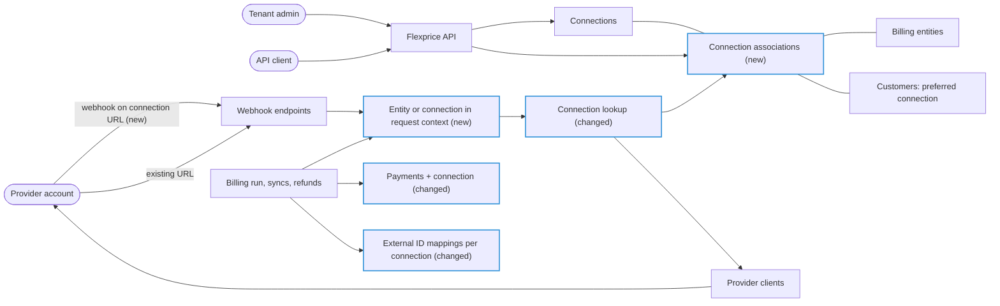
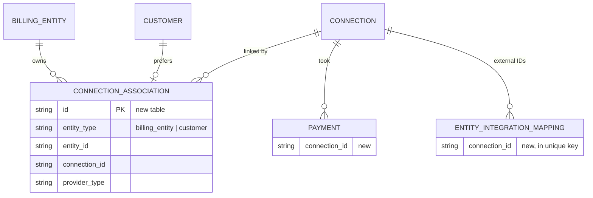
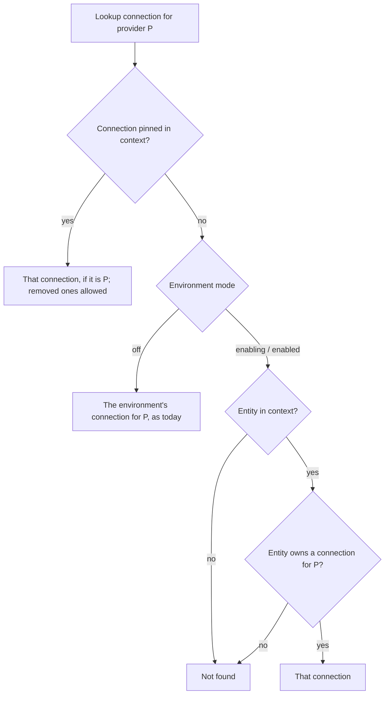
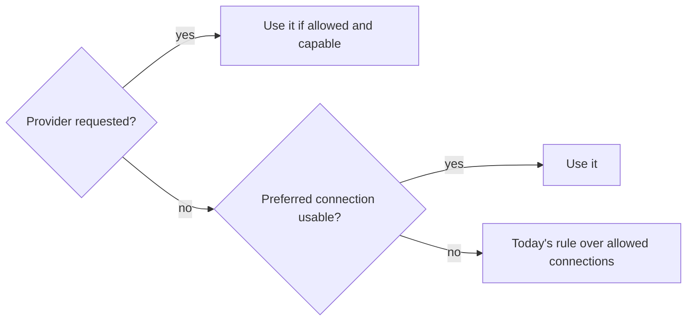
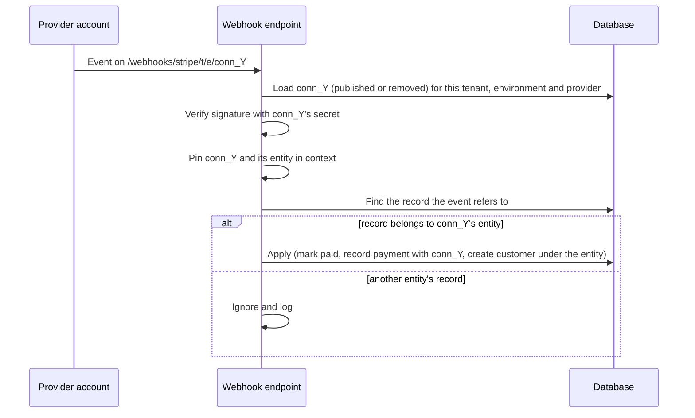

# Billing Entities Phase 2 — Design ERD

Status: In review · Owner: Paras Aghija · Last updated: 2026-10-28
Links: FLE-1695 · Phase 0/1 ERD (`2026-10-27-billing-entities-p1-erd.md`, PR #3258) · overall ERD PR #3165

## 1. Requirement
<!-- erd:locked -->

**Today.** With billing entities enabled, each customer belongs to one entity and their invoices show
that entity as the seller, with its own number prefix and default tax rates. Integrations have not
followed: an environment holds at most one connection per provider (storage exports excepted), and that
connection serves only the default entity. A non-default entity's customers are never auto-charged, get
no checkout, payment links or saved payment methods, cannot pay from the hosted invoice page, and are not
synced to any payment, accounting or CRM integration; their invoices can only be marked paid by hand.

**Gap.** A tenant that sells through several legal entities cannot collect a non-default entity's money
or keep its books in Flexprice. Each company must be paid into its own gateway account and record its
invoices in its own accounting system, so the tenant either collects and books those invoices outside
Flexprice or runs a separate Flexprice tenant per entity.

**Outcome.** Each billing entity can connect its own integration accounts, for example US on Stripe and
India on Razorpay, or two separate Stripe accounts. A customer is charged, synced and refunded only
through their entity's accounts, never another entity's, and inbound webhooks are applied as the entity
whose account sent them. A customer can be given a preferred payment connection from among their
entity's. Environments that never enable billing entities keep today's behaviour.

## 2. Use cases
<!-- erd:locked -->

**UC1 — Tenant admin connects an integration account for an entity.**
1. Admin picks an entity and connects a provider account for it, by API key or by OAuth.
2. The connection belongs to that entity; the entity's integrations list shows it, other entities' lists
   do not.
3. Admin copies the connection's own webhook URL into the provider account.

Variation: the entity already has a connection for that provider → rejected. The environment is off → naming
an entity is rejected and the environment keeps one connection per provider, as today. Storage exports
(S3, GCS) stay environment-wide and belong to no entity.

**UC2 — Billing run collects a non-default entity's invoice.**
1. An invoice is finalized for a customer of a non-default entity.
2. It is auto-charged through the entity's gateway when the customer has a usable saved method there, or
   paid by the end customer through a payment link, checkout or the hosted invoice page served by that
   gateway.
3. The payment records the connection that took it.

Variation: the entity has no gateway connection → the invoice stays pending and is recorded as paid
manually, as in Phase 1. The customer has a preferred connection (UC5) → it is tried first.

**UC3 — Integration sync keeps an entity's accounts up to date.**
1. A customer, invoice, subscription or payment of an entity changes.
2. It is synced to the entity's connection for each provider that syncs that record.
3. Catalog changes (plans, prices, add-ons) are synced to every connection of the provider, each keeping
   its own external IDs.

Variation: the entity has no connection for a provider → that provider's sync is skipped for its records.

**UC4 — Provider sends a webhook.**
1. A provider account posts an event to its connection's webhook URL.
2. Flexprice verifies it with that connection's secrets and applies it as that connection's entity: a
   payment marks the invoice paid, a customer created from the event belongs to that entity.

Variation: the event arrives on the provider's existing environment URL → it is served by the default
entity's connection. The event concerns another entity's record → ignored. The connection was removed →
the late event is still verified and applied.

**UC5 — Tenant admin sets a customer's preferred payment connection.**
1. Admin picks one of the gateway connections the customer may use: their entity's, or the
   environment's when the environment is off.
2. Auto-charge, payment links, checkout and saved payment methods try that connection first.

Variation: the connection is not one the customer may use → rejected. The preferred connection is later
removed, moved to another entity or has no usable saved method → Flexprice falls back to today's choice
among the customer's allowed connections.

**UC6 — Tenant admin moves or removes an entity's connection.**
1. Admin moves an entity to another account of the same provider, or removes a connection, even while the
   entity has open invoices or active subscriptions.
2. New charges and syncs use the entity's current connection; with none, its records behave as in UC2's
   variation.
3. A refund of an earlier payment goes through the connection that took it.

Variation: the connection that took the payment was removed → the refund fails with an error. Customers
and saved payment methods are not copied to the new account; the admin re-syncs them.

## 3. Scope
<!-- erd:locked -->

**In**
- Several connections per provider per environment for enabled environments, each belonging to one entity (UC1).
- Entity ownership for every integration provider except storage exports (UC1).
- Existing connections owned by the default entity at enablement (UC1).
- Connect by API key or OAuth for a chosen entity (UC1).
- Entity-aware connection choice for charges, payment links, checkout, saved methods, syncs and refunds (UC2, UC3, UC6).
- Phase 1's integration guard reduced to entities without a connection for the provider (UC2, UC3).
- Payments record the connection that took them (UC2, UC6).
- External ID mappings and catalog sync per connection (UC3).
- Per-connection webhook URLs; existing URLs kept for the default entity (UC4).
- Customer preferred payment connection (UC5).
- Moving an entity to another account and removing connections with open invoices (UC6).
- Dashboard: integrations per selected entity and a preferred-connection selector on the customer, in the
  portal repo (UC1, UC5).

**Out**
- Stripe Tax per entity; billing entities and external tax engines stay mutually exclusive.
- Razorpay auto-charge (needs mandates).
- A default gateway per entity or tenant, and a payments on/off switch per connection (FLE-1749).
- One provider account shared by several entities (for example one HubSpot portal or one Chargebee site
  with several Chargebee business entities).
- Detecting the same provider account connected twice.
- Copying customers or saved payment methods to a new account when an entity moves.
- Backfilling tenants enabled before this release.
- Entity scoping of storage exports.

## 4. Functional requirements
<!-- erd:locked -->

| ID | Requirement | UC | Acceptance criteria |
|---|---|---|---|
| FR-1 | Connection create and OAuth connect accept an optional `billing_entity_id`; absent means the default entity. It follows Phase 1's entity input rule: rejected unless the environment is `enabled`, and must name an entity of the request's environment. | UC1 | Enabled environment: connect with entity X → connection shows X; without → shows the default's ID. Off environment with an entity → 400 `billing_entities_not_enabled`. |
| FR-2 | In an `enabling` or `enabled` environment, each connection belongs to exactly one entity and each entity has at most one published connection per provider. An off environment keeps at most one published connection per provider. Storage providers keep today's rule and belong to no entity. | UC1 | Second Stripe connection for X → 409; Stripe for X and for Y → both saved; second Stripe on an off environment → 409 as today. |
| FR-3 | Enabling makes the default entity the owner of every existing non-storage connection; a connection created while enabling belongs to the default entity. | UC1 | After enable, every connection except S3/GCS shows the default entity's ID. |
| FR-4 | Connection list accepts an optional `billing_entity_id` filter; connection Get and List carry `billing_entity_id` (null for off environments and storage). | UC1 | Filter by X → X's connections only; off environment → field null. |
| FR-5 | A connection's owner can be changed to another entity that has no connection for the provider; customers and saved payment methods are not copied. | UC6 | Move Stripe 2 from X to Y (Y without Stripe) → saved; Y already has Stripe → 409. |
| FR-6 | Every provider call for a record uses the connection owned by the record's customer's entity; with none, the call behaves as if the provider were not connected. A call never uses another entity's connection. | UC2, UC3 | X on Stripe 1, Y on Stripe 2: charge Y's invoice → Stripe 2 only. Y without Razorpay: Razorpay payment link for Y → 400 provider not connected. |
| FR-7 | For an entity with a connection for the provider, auto-charge, checkout, payment links, saved payment methods, hosted invoice payment and wallet top-up links work as for the default entity; Phase 1's guard applies only when the entity has no connection for that provider. | UC2 | Non-default customer with saved Stripe card and `charge_automatically` → charged through the entity's Stripe; hosted page shows `pay.enabled: true`. |
| FR-8 | Gateway choice: an explicitly requested provider; else the customer's preferred connection if usable; else today's rule over the customer's allowed connections. | UC2, UC5 | Customer prefers Razorpay, has a Stripe card only → auto-charge falls back to Stripe; payment link without provider → Razorpay. |
| FR-9 | A payment taken through a gateway records the connection that took it. | UC2 | Payment response and record show `connection_id` of the entity's connection. |
| FR-10 | Customer, invoice, subscription and payment syncs go to the entity's connection for each syncing provider and are skipped when it has none. | UC3 | Y on QuickBooks realm B → Y's invoice appears in realm B, not realm A; Y without Zoho → no Zoho sync started. |
| FR-11 | Catalog sync pushes plans, prices and add-ons to every connection of the provider and records the external IDs per connection. | UC3 | Price P synced with Stripe 1 and Stripe 2 → two mappings with different external IDs; re-sync does not duplicate. |
| FR-12 | Every connection has its own webhook URL that names the connection. An event on it is verified with that connection's secrets, including for removed connections, and only changes records of that connection's entity. | UC4 | Event on Y's URL for Y's payment → invoice paid; event on Y's URL referencing X's invoice → ignored and logged; event for a removed connection → applied. |
| FR-13 | The existing per-environment webhook URL of each provider stays and is served by the default entity's connection. | UC4 | Event on the old Stripe URL → applied as the default entity. |
| FR-14 | A customer created from a provider event belongs to the entity of the connection that sent it. | UC4 | Stripe 2 (Y) customer-created event → Flexprice customer with Y. |
| FR-15 | A customer can be given and cleared a preferred gateway connection, which must be a gateway connection the customer may use: their entity's in an enabled environment, the environment's otherwise. | UC5 | Set to X's Stripe for a Y customer → 400; set to own entity's Razorpay → saved; clear → removed. |
| FR-16 | A preferred connection that is removed, owned by another entity or lacks a usable saved method is skipped without error. | UC5 | Remove the preferred connection → next charge uses today's choice. |
| FR-17 | A connection can be removed whatever the state of its entity's invoices and subscriptions; its ownership and preferences go with it. | UC6 | Remove Y's Stripe with open invoices → 200; Y's next charge → no gateway, invoice stays pending. |
| FR-18 | A gateway refund uses the connection recorded on the payment; a payment without one uses the connection of its customer's entity for the payment's provider. A removed connection fails the refund. | UC6 | Y moves from Razorpay A to Razorpay B, refund a payment taken in A → refunded in A; A removed → 400 naming the connection. |

## 5. Non-functional requirements
<!-- erd:locked -->

| ID | Category | Requirement (measurable) | How we verify |
|---|---|---|---|
| NFR-1 | Compatibility | An environment that never enables sees identical integration behaviour, webhook URLs and responses, except the added null `billing_entity_id` and `connection_id` fields. | Full integration suite on an off environment before and after; existing webhook URLs replayed. |
| NFR-2 | Compatibility | API changes are additive: no field removed or renamed, every new request field optional. | OpenAPI diff shows additions only. |
| NFR-3 | Security | No provider call for a record of entity X uses a connection owned by entity Y, including list-based choices and webhook handling. | e2e with two Stripe accounts and two QuickBooks companies; audit of every connection list read. |
| NFR-4 | Security | A webhook is accepted only with a valid signature for the connection named in its URL. | e2e: event signed with another connection's secret → rejected. |
| NFR-5 | Performance | Choosing a connection adds at most one cached read per provider call; catalog sync work grows linearly with the number of connections of the provider. | Query count in traces; sync run time with two connections. |
| NFR-6 | Availability | The deploy needs no downtime: pods on the old code keep syncing and charging while the new schema is in place. | Rolling deploy on staging with syncs running. |

## 6. Constraints
<!-- erd:locked -->

| Constraint | Source | Impact on the design |
|---|---|---|
| Tenants paste webhook URLs into their provider accounts by hand; Flexprice does not register them. | Existing integrations | Existing URLs stay forever (FR-13); new connections show their own URL (FR-12). |
| Gateway customers, saved methods, prices and payment IDs exist only inside one provider account. | Providers | External IDs are kept per connection (FR-11); moving an entity copies nothing (FR-5); refunds follow the payment's connection (FR-18). |
| External ID mappings allow one external ID per record per provider. | Existing unique index | The mapping key gains the connection; see migration notes in §9.1. |
| Migrations run before new code, and old pods keep running against the new schema during a deploy. | Deploy process | Schema changes are additive or tolerate old writers (NFR-6). |
| External tax engines use one gateway account's registrations and address. | Stripe Tax | Phase 1's exclusion stays (Out). |
| Razorpay can charge off-session only with a mandate. | Razorpay | No Razorpay auto-charge (Out). |
| OAuth providers return to one fixed callback URL. | QuickBooks, Zoho Books | The entity travels in the OAuth session, not the callback (FR-1). |
| Stripe's account ID is optional and unverified; Razorpay connections store no account ID. | Existing connection data | Duplicate accounts cannot be detected (Out). |
| Assumption: a tenant never connects the same provider account for two entities. | Product | No cross-entity account checks; shared accounts are out of scope. |
| Assumption: some providers cannot be tested with two sandbox accounts. | Provider sandboxes | Those providers ship on code audit plus the fail-closed choice (FR-6, NFR-3). |

## 7. Current state – what we reuse
<!-- erd:locked -->

| Piece | What it gives us | Reuse as-is / extend / replace |
|---|---|---|
| Connections and their API | Create, read, list, update, remove (archive) per environment; encrypted secrets; one published connection per provider, except storage | Extend: entity on create, update, list filter and response; duplicate check per entity |
| Connection lookup by provider | The single path almost every provider client, service and webhook uses to load "the" connection, from a cached per-environment list | Extend: resolves by the entity or connection carried in the request context |
| Published-connections cache | Per-environment cached list, cleared on every connection write | Reuse; associations cached the same way |
| Phase 1 entity resolution | Customer's entity, default-entity fallback while enabling, mode short-circuit for off environments | Reuse to set the entity for each provider call |
| Phase 1 integration guard | Skip or reject points at auto-charge, checkout, pay-first checkout, payment methods, setup intents, payments, hosted page pay, sync APIs, mark-paid dispatch, integration event dispatcher | Extend: the condition becomes "the entity has a connection for this provider" |
| Payment provider choice | Capability map; requested → single capable → "ambiguous"; auto-charge walks gateways alphabetically for a usable saved method | Extend: candidates are the customer's allowed connections, preferred one first |
| External ID mappings | One external ID per record per provider; "already synced" checks; upsert by record and provider | Extend: keyed by connection |
| Catalog and record sync workflows | Retried jobs per plan, price, add-on, customer, invoice, subscription; activities re-read the record | Reuse payloads; catalog activities loop over the provider's connections |
| Webhook endpoints | One public URL per provider per environment; per-provider signature checks against the connection's secrets | Extend: per-connection URL beside the existing one |
| OAuth connect (QuickBooks, Zoho Books) | Session-based connect that creates a pending connection | Extend: session carries the entity |
| Gateway refunds | Refund through the payment's provider (Razorpay, Chargebee today) | Extend: through the payment's connection |
| Customer create from provider events | Stripe, HubSpot, Paddle and Zoho events create customers through the normal create path, which already accepts an entity | Reuse: pass the connection's entity |
| Enable job | Phase 1 Temporal job with an exclusive lock in step 1 | Extend: step 1 assigns existing connections to the default entity |
| Polymorphic association tables | `entity_type` + `entity_id` link pattern used by tax associations and external ID mappings | Reuse the pattern for the new table |

## 8. Solution overview
<!-- erd:locked -->



Main flow (UC1 → UC4):
1. Admin connects Razorpay for entity IN; the connection is associated with IN and shows its own webhook URL.
2. Catalog sync pushes plans and prices into IN's account and records the external IDs for that connection.
3. An IN customer's invoice is finalized; the billing run sets IN as the entity for the call.
4. The lookup resolves IN → its Razorpay connection; the end customer pays through a payment link from that account.
5. Razorpay posts the payment event to the connection's URL; it is verified with that connection's secret.
6. The payment is recorded with the connection and the invoice is marked paid; the invoice syncs to IN's accounting connection.

## 9. Detailed design
<!-- erd:locked -->

### 9.1 Data model



New table `connection_associations` (base, environment and status columns as every environment-scoped table):

| Column | Type | Null | Default | Why |
|---|---|---|---|---|
| `id` | varchar(50) | no | | New id prefix |
| `entity_type` | varchar(50) | no | | `billing_entity` (owner, FR-2) or `customer` (preference, FR-15) |
| `entity_id` | varchar(50) | no | | The entity or customer |
| `connection_id` | varchar(50) | no | | The linked connection |
| `provider_type` | varchar(50) | no | | Copy of the connection's provider, for the per-provider unique key and lookups |

Indexes (all partial on published rows):
- Unique (tenant, environment, `connection_id`) where `entity_type = billing_entity`: one owner per connection.
- Unique (tenant, environment, `entity_id`, `provider_type`) where `entity_type = billing_entity`: one connection per provider per entity.
- Unique (tenant, environment, `entity_id`) where `entity_type = customer`: one preference per customer.
- (tenant, environment, `entity_type`, `entity_id`) for reads.

Changed tables:

| Table | Column / change | Type | Null | Why |
|---|---|---|---|---|
| `payments` | `connection_id` | varchar(50) | yes | Set on every new gateway payment (FR-9); NULL for offline and credit payments and payments taken before this release |
| `entity_integration_mappings` | `connection_id` | varchar(50) | yes until follow-up | External IDs per connection (FR-11) |
| `entity_integration_mappings` | unique key | | | (tenant, environment, entity type, entity ID, provider, `connection_id`) where published, replacing the key without the connection |

Off environments write no association rows except customer preferences; their connections are found as today.

Migration notes:
- Migrations run before the new code and stay safe for old pods (NFR-6).
- **This release:** create `connection_associations`; add `payments.connection_id`; add
  `entity_integration_mappings.connection_id`, fill it on existing rows from the environment's connection
  for the row's provider (one per provider today, so the fill is exact), then drop the old unique index
  and create the new one. The code relies on the index only to report "already exists", so the swap is
  safe in one release. Rows that old pods write during the rollout have no connection and are not covered
  by the new unique key for those few minutes.
- **Follow-up (non-blocking):** fill rows written during the rollout the same way, collapse any duplicate
  among them, and make `entity_integration_mappings.connection_id` required. Nothing waits on it.
- No backfill of associations for tenants enabled before this release (test tenants only). Tenants that
  enable afterwards get them from the enable job (§9.4).

### 9.2 API contracts

**Connections** — existing endpoints

| Endpoint | Change |
|---|---|
| `POST /v1/connections` | Optional `billing_entity_id` (FR-1); duplicate check per entity (FR-2) |
| `PUT /v1/connections/:id` | Optional `billing_entity_id` to move the connection to another entity (FR-5) |
| `GET /v1/connections`, `POST /v1/connections/search` | Optional `billing_entity_id` filter (FR-4) |
| Get, List responses | `billing_entity_id` (FR-4) |
| `DELETE /v1/connections/:id` | Also archives the connection's associations and preferences (FR-17) |
| OAuth connect start (QuickBooks, Zoho Books) | Optional `billing_entity_id`, kept in the OAuth session and applied on completion (FR-1) |

```json
{
  "id": "conn_01J...",
  "name": "Stripe India",
  "provider_type": "stripe",
  "billing_entity_id": "be_01J...",
  "status": "published"
}
```

**Customer preferred connection** (FR-15, FR-16)

| Method | Path | Body / response |
|---|---|---|
| `PUT` | `/v1/customers/:id/preferred-connection` | `{"connection_id": "conn_..."}` → customer |
| `DELETE` | `/v1/customers/:id/preferred-connection` | → customer |

Customer Get and List responses carry `preferred_connection_id` (null when unset).

**Payments** — Get, List and outbound webhooks carry `connection_id` (FR-9).

**Webhooks** — new route per connection, beside the existing one (FR-12, FR-13):

| Route | Serves |
|---|---|
| `POST /v1/webhooks/{provider}/{tenant_id}/{environment_id}/{connection_id}` | That connection, including removed ones |
| `POST /v1/webhooks/{provider}/{tenant_id}/{environment_id}` (existing) | The default entity's connection; the only connection for off environments |

| Error | Status | When |
|---|---|---|
| `billing_entities_not_enabled` | 400 | Entity on connection create, update or filter while not enabled |
| Connection already exists for this entity | 409 | FR-2, FR-5 |
| Connection not allowed for customer | 400 | Preference outside the customer's allowed connections, or not a gateway (FR-15) |
| Provider not connected | 400 | Payment link, checkout or payment method for an entity without that provider (FR-6) |
| Refund connection removed | 400 | FR-18 |
| Unknown or mismatched connection | 404 | Webhook URL names a connection of another provider, tenant or environment |

### 9.3 Flows

**Connection lookup** (FR-6, FR-12, FR-13)

Every entry point that acts on a record (billing run, auto-charge, payment link, checkout, payment
methods, syncs, refunds, catalog sync, provider event handlers) sets the record's customer's entity in the
request context, as Phase 1 already resolves it. Webhook routes set the connection instead.



Not found never falls back to another entity's connection. Callers already treat it as "provider not
connected": syncs skip, auto-charge leaves the invoice pending, requests return 400. Reads that list
connections (gateway choice, invoice-sync provider choice, mark-paid dispatch, invoice pull, mapping
checks, duplicate checks) filter by the context's entity the same way.

**Gateway choice** (FR-8, FR-16)



"Usable" means published, still allowed for the customer, capable of the action and, for auto-charge,
holding a usable saved method. "Allowed" means the customer's entity's connections, or the environment's
for off environments.

**Webhook** (UC4)



**Connection ownership**

- Create in an `enabling` or `enabled` environment writes the owner association in the same transaction,
  under Phase 1's shared enable lock, so it cannot race the enable job.
- Move (FR-5) archives the owner association and writes a new one in one transaction; customer
  preferences pointing at the connection stay and are skipped by FR-16 when no longer allowed.
- Remove (FR-17) archives the connection, its owner association and preferences in one transaction.

### 9.4 Jobs and events

| Job or event | Change |
|---|---|
| Enable job | Step 1 assigns every existing non-storage connection to its environment's default entity (FR-3) |
| Customer, invoice, subscription, payment sync workflows | Payloads unchanged; activities re-read the record and set its entity before the lookup |
| Integration event dispatcher | Sets the record's entity; skip condition becomes "no connection for this provider" |
| Sync parity R1: record-anchored | Every sync of a customer, invoice, subscription or payment (dispatcher, workflow activities, inline updates, `POST /integrations/sync`, payment links, checkout, auto-charge) uses the connection of the record's entity. Payloads unchanged; activities re-read the record and set its entity before the lookup. Catalog items created inside a record sync (Stripe products and prices, Zoho and Chargebee items, Paddle products) follow R1: mappings are keyed by that connection |
| Sync parity R2: payment-anchored | Refunds, payment-status polls and the Moyasar settlement cron use the payment's connection, else its customer's entity (FR-18) |
| Sync parity R3: environment-level push | Runs once per connection of the provider and writes mappings per connection: QuickBooks price push, Chargebee plan and price push, and the marketplace usage report and snapshot crons (already per connection; each is pinned to its connection) |
| Sync parity R4: inbound | Per-connection route; the event is applied as the sending connection's entity, including customers created from events (FR-14) |
| "Already synced" checks | Count mappings for the entity's connection |
| Auto-charge and mark-paid dispatch | Candidates limited to the customer's allowed connections |
| Gateway refunds | Use the payment's connection (FR-18) |
| Inbound provider events | Per-connection route; customers created from them get the connection's entity (FR-14) |
| Outbound webhooks | Payment payloads gain `connection_id` |

### 9.5 Frontend (portal repo)

- **Integrations tab:** with entity X selected, lists X's connections; *Connect* (API key or OAuth)
  creates the connection for X; each connection shows its own webhook URL. Off environments see today's page.
- **Exports:** unchanged; S3 and GCS stay environment-wide.
- **Connection settings:** owner entity, changeable to an entity without a connection for that provider.
- **Customer page:** preferred payment connection selector listing only the customer's allowed gateway
  connections, with a clear option.

## 10. Cross-cutting concerns
<!-- erd:locked -->

| Concern | How the design handles it | NFR |
|---|---|---|
| Backward compatibility | Off environments keep today's lookup, duplicate rule and URLs; new fields optional or null | NFR-1, NFR-2 |
| Isolation between entities | One lookup path that fails closed; list-based reads filtered by entity; webhook handling ignores other entities' records; mandatory audit of every connection list read | NFR-3 |
| Webhook authenticity | Secret of the connection named in the URL; the connection must match the URL's tenant, environment and provider | NFR-4 |
| Concurrency: enable vs connection create | Ownership written under Phase 1's shared enable lock; step 1 holds the exclusive lock | — |
| Stale tenant-mode cache | Entity inputs re-read the mode from the database (Phase 1 rule); until enabled, an environment has one connection per provider, so a stale "off" lookup finds the same connection | NFR-3 |
| Caching | Associations cached per environment beside the published-connections list and cleared on every connection or association write | NFR-5 |
| Idempotency | Mapping upserts and "already synced" checks keyed by connection; webhook handlers keep today's idempotency | — |
| Failure: entity without a connection | Behaves as "not connected": invoice pending, sync skipped, 400 on requests; logged with record and entity IDs | NFR-3 |
| Failure: late event for a removed connection | Still verified and applied through the per-connection route | — |
| Deploy safety | Additive schema; mapping index swap tolerated by old pods; non-blocking follow-up | NFR-6 |
| Observability | Lookup misses for enabled environments and ignored cross-entity webhook events are logged with tenant, entity, connection and record IDs | — |
| Multi-tenancy | Associations are tenant- and environment-scoped; webhook connection must belong to the URL's tenant and environment | NFR-4 |

## 11. Risks & open questions
<!-- erd:locked -->

| Risk | Likelihood / Impact | Mitigation |
|---|---|---|
| A connection list read is missed and picks another entity's account | Medium / High | Mandatory audit of every list read; e2e with two Stripe accounts and two QuickBooks companies |
| Providers without two sandbox accounts ship untested per entity | High / Medium | Fail-closed lookup turns a miss into a skipped sync or rejected request, never a wrong account |
| Tenant connects one provider account for two entities | Low / High | Documented as unsupported; account checks out of scope |
| Tenant keeps a non-default entity's events on the old URL | Medium / Medium: events applied as the default entity are ignored for other entities' records | Integrations tab shows each connection's URL; release notes |
| Duplicate mapping rows written by old pods during the rollout | Low / Low | Follow-up fill collapses them |
| Moving an entity to a new account leaves customers and cards behind | Medium / Medium | Documented manual re-sync (UC6) |

Release order (decided 2026-10-28): Phase 0/1 → per-prefix numbering follow-up → this release → first environment enables.

| Question | Owner | Blocks |
|---|---|---|
| Split into two PRs (mechanism + Stripe/Razorpay, then list-read audit + remaining providers) or one? | Paras | Implementation plan |
| Feature flag on the enable endpoint, or release checklist? | Paras | Release |
| Settings cache read and Phase 1 deferred minors: ship with this release or separately? | Paras | Release |
